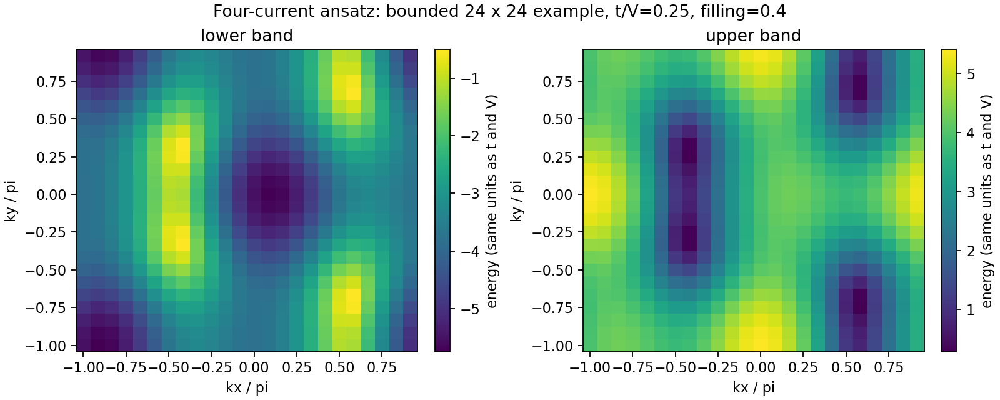

# Bond ordering in flux phases

Code and reconstruction notes associated with Yifan Liu and Vivek Aji,
**Bond ordering in flux phases of interacting spinless fermions on the square
lattice**, Physical Review B **113**, 045140 (2026).
[DOI](https://doi.org/10.1103/3jqj-28q7) |
[arXiv:2402.09577](https://arxiv.org/abs/2402.09577).

This is the existing `lyfstefan/1988_Affleck` repository, with its history
preserved. An October 2026 audit found that the older exploratory code
differs from the paper's four-current ansatz. This release therefore makes
the distinction explicit:

* **`loop_current/` is a new, paper-based implementation** of the four real
  bond-current variables, band energies and zero-temperature canonical
  energy. It was reconstructed in 2026, not recovered as original paper code.
* **`1988_Affleck_code/` is the preserved historical exploratory source.**
  Its independent complex-bond amplitudes/phases, energy functional and
  heuristic phase labels are not validated as the published model.
  It also contains a band-energy defect, `np.abs(h12)**0.5`, where a
  Hermitian two-band matrix requires `np.abs(h12)`. Do not use its outputs
  as verified paper reproduction. See [the audit](docs/source_audit.md).

All phase-space statements concern a **restricted loop-current mean-field
ansatz**. Competition with charge-density-wave and other orders is absent;
this is not the complete ground-state phase diagram of the interacting model.

## Run the paper-based model

From the root, using Python 3.11:

```sh
python -m pip install -r requirements.txt
OPENBLAS_NUM_THREADS=1 python -m unittest discover -s tests -v
OPENBLAS_NUM_THREADS=1 python -m validation.run
OPENBLAS_NUM_THREADS=1 python -m examples.paper_model
```

The example uses t=1, t'=0.2, V=4, filling=0.4, a deliberately small 24x24
momentum mesh and three seeded searches. It writes a band PNG, NPZ and JSON
with currents, energies, optimizer settings and each refinement's status to
`examples/output/`. It is a bounded executable example, not a converged
reproduction of the paper's phase diagram or a certified global minimum.
Use `--mesh`, `--maxiter`, `--t`, `--tp`, `--interaction`, and `--filling`
to change its settings. `validation/report.json` records bounded checks.

## Model and normalization

Directions are (+x,+y,-x,-y), with four real current expectations J_nu.
The paper's hopping is

```
t_nu = t + i V J_nu
h_AB(k) = -sum_nu t_nu exp(i k.e_nu)
E_+/- = -4 t' cos(kx) cos(ky) +/- |h_AB(k)|
energy_per_site = V/4 sum_nu J_nu^2 + electronic_energy_per_site
```

The Bloch Hamiltonian is Hermitian: the lower off-diagonal element is the
complex conjugate of the upper one. The closed-form bands are checked
against direct Hermitian diagonalization.

A full square Brillouin-zone grid is used. The two-sublattice representation
double counts the folded bands, so **every entry carries weight 1/2**.
For Nk momentum points and filling nu in [0,1], the calculation occupies
`2*Nk*nu` entries, then divides their energy sum by `2*Nk`. A fractional last
entry gives exact canonical filling, including degenerate shells. This
avoids the old chemical-potential bisection's occupation-tolerance issue.
The mesh must be even so the folding partner k+(pi,pi) is represented.

Annealing searches four currents with an explicitly reported default
[-1,1] box, then refines locally with L-BFGS-B. The feasible zero-current
trial is retained as a baseline. Seeds, objective values, local statuses
and proximity to the search boundary are saved. No publication phase names
are inferred from the old eight-parameter heuristic classifier. The paper's
SHGO/RLEX procedure and its separate net-zero-flux constraint are not
implemented in this release.

## Checks and limitations

The checks cover independent band diagonalization, the free square-lattice
dispersion, folded counting, exact filling, time reversal and C4 symmetry,
particle-hole symmetry at t'=0, empty/full filling, a continuum free-lattice
energy, an analytic staggered-current trial family, fixed-trial mesh
convergence, and a small seeded minimization. Fixed-trial convergence is
not convergence of optimized phase boundaries. The new numerical example
does not reuse or certify any old NPY/PNG/PDF result file.

The existing data files and sources remain for historical inspection.
Fingerprints identify the preserved Python files. The supplied local Physics
originals were read only. Sources from the neighboring `1988_Affleck_tp` /
`1999_Affleck_code` project were not mixed into this release.

Cite the paper using `citation.bib` or `CITATION.cff`.

## Generated example


