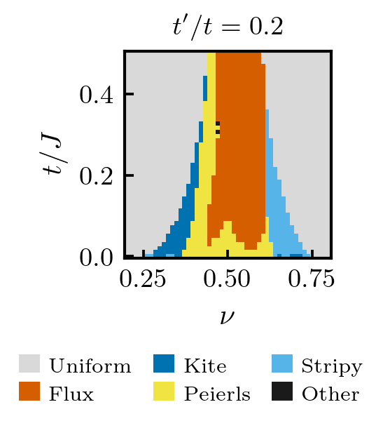

# Affleck mean-field flux phases

Square-lattice mean-field calculations with four complex bond parameters.
The code compares uniform, flux, kite, Peierls and stripe-like configurations
as functions of filling and hopping strength.



## Bond parameters and numerical conventions

The four bonds point along $(+x,+y,-x,-y)$ and are parametrized by amplitudes
$\chi_i$ and phases $\phi_i$. The off-diagonal matrix element is

$$
h_{AB}(\mathbf{k})=-\sum_{i=1}^{4}
\left(t+\chi_i e^{-i\phi_i}\right)e^{i\mathbf{k}\cdot\mathbf{e}_i}.
$$

For reproducing the saved scans, the dispersion evaluated in
`bandstructure.py` is

$$
E_\pm(\mathbf{k})=-4t'\cos k_x\cos k_y\pm\sqrt{|h_{AB}(\mathbf{k})|}.
$$

The square root in this expression is part of the saved calculation's
numerical convention. The energy minimized by `solver.py` is

$$
\varepsilon=\frac{1}{2N_s}\sum_{\mathbf{k},s}^{E_s\leq\mu}E_s(\mathbf{k})
+\frac{1}{2J}\sum_i\chi_i^2,
$$

where $N_s=N_xN_y$ and $\nu=N/N_s$. The chemical potential is chosen by
bisection with the configured particle-count tolerance. The scripts use
$J=1$; bond phases are in radians. Optimization combines dual annealing
with local L-BFGS-B minimization.

The displayed square flux is
$\Phi\equiv-\theta_1+\theta_2-\theta_3+\theta_4\pmod{2\pi}$, with
$\theta_i=\arg(t+\chi_i e^{-i\phi_i})$. The figures display $\Phi/\pi$ in $[0,2)$ using a cyclic color scale.

## Installation and saved figures

Run from the repository root with Python 3.11:

```sh
python -m pip install -r requirements.txt
python 1988_Affleck_code/replot_saved.py
```

This reads the saved scans and exports a phase map, an eight-panel
$(\chi_i,\phi_i)$ map and a flux map for each scan. It does not repeat the
energy minimization. Figures are written to
`1988_Affleck_code/results/figs/` in PDF, SVG and 300 dpi PNG format.

Figure export requires LaTeX with `latex`, `dvipng`, `type1cm`, `type1ec`,
`amsmath` and `textcomp`. On Ubuntu:

```sh
sudo apt-get install texlive-latex-extra cm-super dvipng ghostscript
```

## Saved parameter scans

| Scan | Parameter grid | $N_s$ | Filling range | $t/J$ range |
| --- | --- | ---: | --- | --- |
| `20250626_224949` | $40\times40$ | 10000 | 0.2–0.5 | 0–0.5 |
| `20250626_234707` | $20\times20$ | 2500 | 0.2–0.5 | 0–0.5 |
| `20250628_175145` | $50\times50$ | 2500 | 0.2–0.8 | 0–0.5 |

Particle numbers and hopping values are read from each scan. The historical
site counts follow from those particle numbers and the original filling
axes. The last phase map retains its original $t'/t=0.2$ annotation; the NPY
files do not contain a complete record of the run settings.

The saved phase maps retain the classifications plotted in the original
figures. Their cell labels are stored in `results/classification/`, and the
original figures are kept in `results/figs/originals/`, both relative to
`1988_Affleck_code/`. For new calculations, `phase_classify.py` assigns the
categories using the bond-amplitude and phase tolerances. In order-parameter
plots, $\phi_i$ is displayed as zero when $|\chi_i|<10^{-3}$; the saved
numerical values are unchanged.

## New calculations and checks

Set the lattice, filling range and hopping range in
`1988_Affleck_code/config.py`, then run:

```sh
cd 1988_Affleck_code
python main.py
```

From the repository root, the data and figure checks are:

```sh
python -m unittest discover -s tests -v
```

The checks cover saved-grid coordinates, row-order independence and phase
labels at selected locations in the original figures. Source checksums,
phase counts and figure geometry are recorded in
[the figure validation report](docs/figure_validation.json).
The [code guide](1988_Affleck_code/README.md) describes the data columns and
plotting functions. This project is separate from
[bond-order-flux-phases](https://github.com/lyfstefan/bond-order-flux-phases).

## Related reference

I. Affleck and J. B. Marston, “Large-$n$ limit of the Heisenberg-Hubbard model:
Implications for high-$T_c$ superconductors,” *Phys. Rev. B* **37**, 3774 (1988).
[DOI:10.1103/PhysRevB.37.3774](https://doi.org/10.1103/PhysRevB.37.3774).
